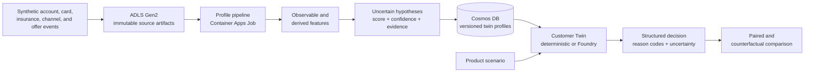
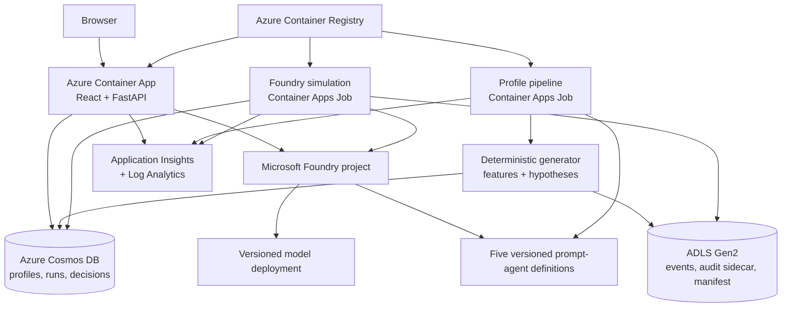

# Foundry Financial Digital Twins

[Português (Brasil)](README.pt-BR.md)

> [!CAUTION]
> **Synthetic scenario—not a forecast.** Outputs show how a versioned simulation
> responds to fictional Agro profiles under stated assumptions. They do **not**
> estimate demand, revenue, credit risk, product-market fit, or the behavior of
> any real person.

Foundry Financial Digital Twins is a non-production reference implementation
for testing financial-product configurations against a controlled population of
synthetic customer agents before selecting hypotheses for real customer
research. It combines a reproducible population generator, paired
counterfactuals, an auditable deterministic baseline, optional Microsoft
Foundry execution, Azure persistence, and an explainable web experience.

This repository is **not approved for production financial decisioning**. It
must not be used for credit, underwriting, pricing, eligibility, limits,
collections, advice, or any other consequential decision. It is an independent
reference implementation; use of Microsoft product names does not imply
Microsoft endorsement.

## Why this exists

Traditional segmentation compresses many people into a few averages. This
project adds a controlled panel of fictional customers so a team can ask:

- Which synthetic profiles resist each product configuration?
- Which objections repeat?
- Which preregistered treatment changes alter scenario responses?
- Which hypotheses are worth testing in a properly governed real-world pilot?

The value proposition is **hypothesis reduction, not market prediction**. The
same population and seed are replayed across price, protection, grace-period,
digital-service, advisor-access, cashback, and reversibility settings. That
paired design makes scenario differences inspectable without claiming that the
synthetic population represents real-world prevalence.

## Demo experience

The current React experience presents one segment, 120 fictional histories, and
different decisions. A user can:

1. compare three initial `Agro Flex` variants;
2. explore agents on a digital-autonomy × liquidity-preference map;
3. open one profile and trace `event → feature → hypothesis → decision`;
4. change a monthly fee, cashback, protection, grace period, digital experience,
   or specialist access;
5. replay the same population and seed;
6. inspect who changed choice and which evidence-backed factors contributed;
7. switch from the deterministic baseline to a 24-profile Foundry run when
   Foundry is configured.

The choices are `accept`, `consider`, `request_change`, and `reject`. The
`fit_score` is scenario affinity on a 0–100 scale—not purchase probability.
The current application UI is localized in Portuguese; the repository
documentation is English-first.

The three default variants are:

| Variant | Scenario proposition |
|---|---|
| **Agro Flex Liquidez** | Season-aligned grace period and flexible cancellation |
| **Agro Flex Protecao** | Broad protection bundle with specialist support |
| **Agro Flex Digital Rewards** | Lower operating cost and category-relevant cashback |

The demo tests proposition fit only. It never approves credit, sets an
individual price or limit, or determines eligibility.

## Hyper-personalization flow



The large language model does not generate the population. A deterministic,
versioned generator creates 12 months of synthetic usage, derives features, and
builds explicitly uncertain hypotheses. The agent receives only the allowed
profile and product scenario, must preserve unknowns, and may cite only supplied
evidence identifiers.

## Population modes

The profiles are logical, ephemeral agent instances—not one Azure resource per
customer.

| Mode | Intended use | Current behavior |
|---|---|---|
| **24** | Interactive Foundry demo and smoke evaluation | The API enforces this ceiling for interactive Foundry requests |
| **120** | Standard coverage study | Default deterministic demo and provisioned Foundry batch job |
| **500** | Scale and contract validation | Supported by deterministic generation/API bounds; review cost before any custom Foundry run |

The standard 120-profile panel contains 15 profiles for each of eight
exploratory behavioral anchors. It maximizes coverage; it does not estimate how
common an anchor is in the real Agro market. Traits remain continuous and
correlated, and anchors are navigation aids rather than personality labels.

## Five Foundry agents

`python -m financial_twins provision-agents` creates or reuses five versioned
prompt-agent definitions. Definition hashes prevent unnecessary new versions.

| Agent | Responsibility | Current runtime status |
|---|---|---|
| `customer-twin` | Produce one structured fictional customer response while preserving epistemic layers and evidence bounds | Invoked by the Foundry simulation path |
| `product-expert` | Check scenario completeness and internal consistency across price, benefit, eligibility, service, reversibility, and disclosure fields | Provisioned; not yet orchestrated |
| `risk-policy-critic` | Critique unsupported inference, proxy leakage, unfair treatment, manipulation, false precision, and consequential use | Provisioned; not yet orchestrated |
| `scenario-designer` | Design controlled variants while changing only preregistered treatment parameters | Provisioned; not yet orchestrated |
| `portfolio-analyst` | Summarize structured scenario signals, heterogeneity, objections, uncertainty, and real-world validation needs | Provisioned; not yet orchestrated |

Only `customer-twin` participates in the implemented simulation workflow today.
The other definitions are governance-oriented building blocks, not a claim that
a five-agent orchestration is already implemented.

## Simulation engines

| Capability | `deterministic` | `foundry` |
|---|---|---|
| Azure required | No | Yes |
| Decision method | Transparent weighted utility decomposition | Structured model response through a prompt agent or direct model |
| Reproducibility | Stable for the same versioned inputs | Model outputs may vary |
| Interactive panel | Up to API limit | Capped at 24 profiles |
| Standard 120 run | Local CLI | Manual Container Apps batch job |
| Failure behavior | Explicit validation errors | Provider/response errors are surfaced; there is no silent deterministic fallback |

Both engines emit the same `TwinDecision` contract with engine provenance,
choice, fit score, confidence, reasons, evidence IDs, requested changes, missing
information, unsupported inferences, and policy flags. Foundry work is bounded
to eight concurrent evaluations. Each run records the population digest,
scenario hash, engine, model deployment, agent name, semantic version,
definition-hash prefix, and invocation
mode.

If `FOUNDRY_CUSTOMER_TWIN_AGENT` is configured, the runtime uses that Foundry
prompt agent. If it is omitted, the SDK calls the configured model deployment
directly with the bounded customer-twin instructions. These modes are recorded
as `prompt-agent` and `direct-model`, respectively.

## Architecture



### Azure resources

The Bicep deployment creates an isolated, removable non-production resource
group containing:

- a Microsoft Foundry account, project, fixed-version model deployment, and
  prompt-agent definitions;
- one Azure Container Apps environment;
- a scale-to-zero web Container App serving React and FastAPI;
- a manual profile-pipeline Container Apps Job;
- a manual 120-profile Foundry simulation Container Apps Job;
- serverless Azure Cosmos DB;
- an ADLS Gen2-enabled Storage account and private `raw-events` container;
- Azure Container Registry;
- Application Insights and a Log Analytics workspace.

Workloads use system-assigned managed identities and Azure RBAC.
Key-based/local authentication is disabled for Foundry, Storage, and Cosmos DB.
The current reference deployment still uses public service endpoints, and web
ingress is restricted only by a caller-supplied CIDR. See
[Architecture](docs/architecture.md) and the [threat model](docs/threat-model.md)
before deploying.

## Data contracts and storage roles

The Pydantic contracts keep epistemic layers separate:

| Layer | Contract examples | Meaning |
|---|---|---|
| `O` | `UsageMonth`, observable `EvidenceValue` | Synthetic observations such as app sessions or balances |
| `D` | derived `EvidenceValue` | Computed features such as working-capital pressure |
| `H` | `TraitHypothesis` | Uncertain score, confidence, method version, and evidence IDs |
| `S` | `ProductVariant` | Scenario treatment, including fee, cashback, protection, and service settings |
| `R` | `TwinDecision`, `SimulationResult` | Engine output and run-level provenance |
| `A` | `AuditRecord` | Segregated latent traits and synthetic audit group used to test the generator |

`TwinProfile.agent_payload()` excludes the population seed. The audit sidecar
and raw monthly events are never included in the agent payload.

### Cosmos DB: operational query layer

| Container | Partition key | Role |
|---|---|---|
| `customerTwins` | `/id` | Current versioned operational profile |
| `simulationRuns` | `/id` | Population manifests, run manifests, versions, status, and summaries |
| `twinDecisions` | `/twin_id` | One decision per run, variant, and twin |

Cosmos DB supports API/UI access patterns. The low-cardinality `Agro` segment is
deliberately not a partition key.

### ADLS Gen2: immutable artifact layer

Each validated population is written under its artifact digest with:

- `events.jsonl` — 12 monthly synthetic usage rows per profile;
- `audit-sidecar.jsonl` — generator-only latent/audit attributes;
- `manifest.json` — seed, versions, specification hash, profile digest, artifact
  digest, and anchor counts.

Large event history and audit artifacts stay out of the operational profile.
Azure publication is blocked if deterministic population validation fails.

## Quickstart

### Prerequisites

- Python 3.13 (the package supports `>=3.13,<3.15`)
- Node.js 22+
- pnpm 12.16.1
- PowerShell for the commands below

From the repository root:

```powershell
python -m venv .venv
.\.venv\Scripts\python -m pip install -e ".[dev]"

Push-Location ui
pnpm install --frozen-lockfile
pnpm build
Pop-Location

.\.venv\Scripts\python -m financial_twins validate --count 120
.\.venv\Scripts\python -m uvicorn financial_twins.api:app --reload
```

Open `http://localhost:8000`. With no Azure environment variables, `/api/demo`
generates the standard population in memory and runs the deterministic engine.

### Common local commands

```powershell
# Write manifest, profiles, events, and audit sidecar to output.
.\.venv\Scripts\python -m financial_twins generate --count 120 --output output

# Validate generator and population invariants
.\.venv\Scripts\python -m financial_twins validate --count 120

# Write a deterministic three-variant simulation
.\.venv\Scripts\python -m financial_twins simulate --count 120 --output output\simulation.json

# Run the API after the UI has been built
.\.venv\Scripts\python -m uvicorn financial_twins.api:app --reload

# Optional UI development server
Push-Location ui
pnpm dev
Pop-Location
```

All population commands accept `--seed`; the default is `agro-demo-2026`.

### Local Foundry execution

Authenticate with Azure, then configure generic project and deployment values:

```powershell
az login
$env:FOUNDRY_PROJECT_ENDPOINT = "https://<foundry-resource>.services.ai.azure.com/api/projects/<project-name>"
$env:AZURE_AI_MODEL_DEPLOYMENT_NAME = "<model-deployment-name>"

# Create or reuse all five prompt-agent definitions.
.\.venv\Scripts\python -m financial_twins provision-agents

# Select the implemented prompt agent and run the live-size panel.
$env:FOUNDRY_CUSTOMER_TWIN_AGENT = "customer-twin"
.\.venv\Scripts\python -m financial_twins simulate-foundry --count 24 --output output\foundry-simulation.json
```

Omit `FOUNDRY_CUSTOMER_TWIN_AGENT` only when intentionally testing direct-model
mode. Foundry execution incurs model usage and requires the caller to have
appropriate project access.

## Deploy to Azure with `azd`

### Additional prerequisites

- Azure CLI and Azure Developer CLI (`azd >= 1.37.0`)
- Docker
- PowerShell 7
- permission to create the listed Azure resources and role assignments
- registered resource providers, model availability, and sufficient quota in
  the selected region

Use only your own environment values:

```powershell
az login
azd auth login
azd env new fdt-demo
azd env set AZURE_SUBSCRIPTION_ID "<subscription-id>"
azd env set AZURE_LOCATION "<azure-region>"
azd env set DEMO_ALLOWED_IP_CIDR "<public-ip>/32"

# Optional: override defaults with a model/version/SKU available in your region.
azd env set AZURE_AI_MODEL_NAME "<model-name>"
azd env set AZURE_AI_MODEL_VERSION "<model-version>"
azd env set AZURE_AI_MODEL_SKU "<model-sku>"
azd env set AZURE_AI_MODEL_CAPACITY "<capacity>"

azd up
```

The preprovision hook checks provider registration, model availability, SKU,
and incremental quota. The postdeploy hook updates both jobs to the deployed web
image, starts the profile pipeline, provisions the five agents, generates and
validates 120 profiles, and persists the canonical population. A successful
deployment is still a non-production demo, not a banking control environment.

### Run the 120-profile Foundry batch job

The provisioned job evaluates three variants for 120 profiles—360 model
requests—then persists profiles/artifacts and structured run decisions. It has a
two-hour execution timeout, no replica retry, and a concurrency bound of eight
inside the application. Review quota and cost before starting it.

```powershell
$subscription = azd env get-value AZURE_SUBSCRIPTION_ID
$resourceGroup = azd env get-value AZURE_RESOURCE_GROUP
$job = azd env get-value FOUNDRY_BATCH_JOB_NAME

$execution = az containerapp job start `
  --subscription $subscription `
  --resource-group $resourceGroup `
  --name $job `
  --query name `
  --output tsv

az containerapp job execution show `
  --subscription $subscription `
  --resource-group $resourceGroup `
  --name $job `
  --job-execution-name $execution `
  --query properties.status `
  --output tsv
```

The interactive API intentionally rejects Foundry populations above 24; use the
manual job for the standard 120-profile Foundry study.

## Testing and validation

Run the same local gates used by CI:

```powershell
.\.venv\Scripts\python -m ruff check .
.\.venv\Scripts\python -m pytest
.\.venv\Scripts\python -m financial_twins validate --count 120

Push-Location ui
pnpm build
pnpm lint
Pop-Location

az bicep build --file infra/main.bicep
az bicep build --file infra/resources.bicep
```

The deterministic validation covers schema and bounds, evidence provenance,
audit-sidecar isolation, exact reproducibility, all eight anchors, duplicate
detection, event/audit integrity, structural rules, and trait-space diversity.
Foundry checks are separate because they incur model usage; they must verify
structured output, preserved IDs, valid evidence references, prohibited-use
behavior, and stability. LLM judges never replace deterministic contracts or
human review. See
[Methodology](docs/methodology.md) and [Evaluations](evaluations/README.md).

## Cost and cleanup

Deployment can incur charges for model tokens/capacity, Container Apps
executions, Container Registry, Cosmos DB, Storage, Application Insights, and
Log Analytics. Scale-to-zero does not remove stored data or every standing
resource charge. Costs vary by region, model, retention, and workload; use the
[Azure pricing calculator](https://azure.microsoft.com/pricing/calculator/) and
set budgets/alerts before deployment.

Delete the selected environment when finished:

```powershell
azd down --purge
```

Confirm deletion in your Azure account, including soft-deleted or separately
retained resources, and remove any local `output\` artifacts according to your
data-handling policy.

## Security and privacy

- Use synthetic data only. Do not submit customer data, personal data,
  credentials, secrets, or confidential business information.
- Managed identities, RBAC, TLS, disabled local auth, private blob access, and
  bounded agent payloads reduce risk; they do not make this production-ready.
- The reference web app uses an IP allow-list rather than Microsoft Entra
  application authentication.
- Foundry, Storage, Cosmos DB, ACR, and telemetry endpoints remain publicly
  reachable in the reference topology, subject to identity/service controls.
- Model deployments using a global SKU can process outside the deployment
  region; review current Azure terms and data-zone requirements.
- Telemetry should contain IDs, versions, hashes, latency, and token counts—not
  raw profiles, audit attributes, or sensitive content.
- A banking deployment would additionally require private endpoints, VNet
  integration, private DNS, controlled egress, application authentication,
  organization policy, key-management decisions, monitoring, and incident
  response.

Read [SECURITY.md](SECURITY.md) and [docs/threat-model.md](docs/threat-model.md).
Report vulnerabilities through GitHub private vulnerability reporting, never a
public issue.

## Responsible AI and banking model risk

### Intended use

- product and journey ideation;
- controlled counterfactual comparison;
- edge-case and objection discovery;
- generation of hypotheses for governed real-world research.

### Prohibited use

- underwriting, credit, limits, individual pricing, eligibility, or
  collections;
- adverse financial treatment or behavioral manipulation;
- forecasts of adoption, demand, revenue, or product-market fit;
- inference of health, vulnerability, religion, ethnicity, or protected
  attributes;
- action on behalf of a real customer;
- replacement of customer research, compliance, model risk, fair-lending
  review, security review, or independent validation.

The population is synthetic and behaviorally **not calibrated**. Plausible model
language is not empirical evidence; fit scores are not probabilities; repeated
model agreement is not accuracy; and scenario fairness metrics do not establish
legal compliance. Any change in data, generator, model, prompt, agent, tool,
evaluator, policy, or intended use requires revalidation.

Treat the system as a model-risk artifact subject to inventory, documented
purpose, effective challenge, change control, outcome monitoring, and approval
appropriate to the institution and jurisdiction. The project references, but
does not claim compliance with, the NIST AI RMF or U.S. banking guidance
SR 11-7. See [Responsible AI](docs/responsible-ai.md) and the
[Simulation Card](docs/simulation-card.md).

## Future: customer-authorized preference proxy

A possible future system would represent a real customer's explicit
preferences **for that customer**, not reuse the bank's product-testing
objective. Its enforceable priority would be:

```text
law and safety
  > the customer's latest explicit constraints and preferences
  > the customer's stated financial objective
  > a disclosed institutional objective, only when compatible
```

That future proxy is not implemented. It would require purpose-specific
consent, inspection and correction of inferences, revocation and deletion,
conflict-of-interest tests, fresh confirmation for consequential actions, and a
firewall against reuse for underwriting, pricing, or collections. See
[Customer-Authorized Preference Proxy](docs/customer-proxy.md).

## Repository structure

```text
.github/                 CI, CodeQL, dependency, and community templates
docs/                    Architecture, methodology, RAI, threat model, and guides
evaluations/             Evaluation guidance
infra/                   Azure Bicep
scripts/                 Azure preflight, postdeploy, and Foundry smoke helpers
src/financial_twins/     Population, contracts, simulation, persistence, API, agents
tests/                   Contract, generator, simulation, persistence, and API tests
ui/                      React/Vite demonstration UI
```

## Roadmap

Potential next steps, subject to review:

- orchestrate and evaluate the four governance-oriented Foundry agents;
- add an English UI locale, screenshots, and a formal accessibility audit;
- add Entra application authentication, private networking, and controlled
  egress for a hardened deployment profile;
- expand Foundry stability, safety, fairness, and placebo evaluations;
- publish a software bill of materials and complete third-party license review;
- calibrate only after approved real-world research, independent validation, and
  a documented change of intended use;
- design the customer-authorized preference proxy as a separate,
  consent-centered system.

## Documentation

- [Architecture](docs/architecture.md)
- [Methodology and evaluation](docs/methodology.md)
- [Responsible AI](docs/responsible-ai.md)
- [Simulation Card](docs/simulation-card.md)
- [Threat model](docs/threat-model.md)
- [Demo script](docs/demo-script.md)
- [Future customer proxy](docs/customer-proxy.md)
- [Public-release checklist](docs/public-release-checklist.md)
- [Portuguese README](README.pt-BR.md)

## Community and governance

- Contributions: [CONTRIBUTING.md](CONTRIBUTING.md)
- Code of conduct: [CODE_OF_CONDUCT.md](CODE_OF_CONDUCT.md)
- Security reporting: [SECURITY.md](SECURITY.md)
- Support: [SUPPORT.md](SUPPORT.md)
- Changes: [CHANGELOG.md](CHANGELOG.md)
- Citation: [CITATION.cff](CITATION.cff)

## Public references

- [Microsoft Foundry Agent Service](https://learn.microsoft.com/azure/foundry/agents/overview)
- [Microsoft Foundry architecture](https://learn.microsoft.com/azure/foundry/concepts/architecture)
- [Microsoft Foundry observability](https://learn.microsoft.com/azure/foundry/concepts/observability)
- [Responsible AI for Azure OpenAI](https://learn.microsoft.com/azure/foundry/responsible-ai/openai/overview)
- [Azure Cosmos DB data modeling](https://learn.microsoft.com/azure/cosmos-db/modeling-data)
- [NIST AI Risk Management Framework](https://www.nist.gov/itl/ai-risk-management-framework)
- [Federal Reserve SR 11-7: Guidance on Model Risk Management](https://www.federalreserve.gov/supervisionreg/srletters/sr1107.htm)

## License

Licensed under the [MIT License](LICENSE). The license does not make this
reference implementation approved for customer use or production financial
decisioning.
