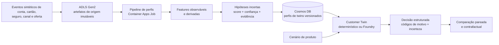
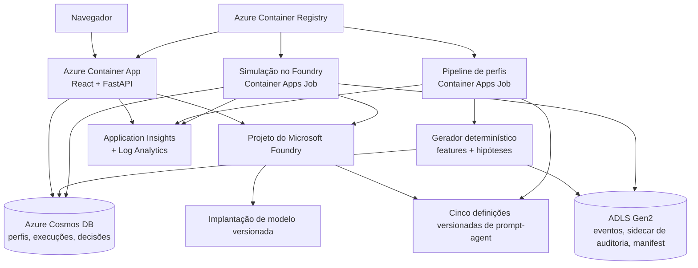

# Foundry Financial Digital Twins

[English](README.md)

> [!CAUTION]
> **Cenário sintético — não é uma previsão.** As saídas mostram como uma
> simulação versionada responde a perfis Agro fictícios sob as premissas
> declaradas. Elas **não** estimam demanda, receita, risco de crédito,
> adequação do produto ao mercado nem o comportamento de qualquer pessoa real.

Foundry Financial Digital Twins é uma implementação de referência não produtiva
para testar configurações de produtos financeiros com uma população controlada
de agentes de clientes sintéticos antes de selecionar hipóteses para pesquisas
com clientes reais. Ela combina um gerador de população reproduzível,
contrafactuais pareados, um baseline determinístico auditável, execução opcional
no Microsoft Foundry, persistência no Azure e uma experiência web explicável.

Este repositório **não está aprovado para decisões financeiras em produção**.
Ele não deve ser usado para crédito, subscrição de risco, precificação,
elegibilidade, limites, cobrança, aconselhamento ou qualquer outra decisão
consequencial. Esta é uma implementação de referência independente; o uso de
nomes de produtos da Microsoft não implica endosso da Microsoft.

## Por que este projeto existe

A segmentação tradicional comprime muitas pessoas em poucas médias. Este
projeto acrescenta um painel controlado de clientes fictícios para que uma
equipe possa perguntar:

- Quais perfis sintéticos resistem a cada configuração de produto?
- Quais objeções se repetem?
- Quais mudanças de tratamento pré-registradas alteram as respostas ao cenário?
- Quais hipóteses valem a pena testar em um piloto real com governança adequada?

A proposta de valor é a **redução de hipóteses, não a previsão de mercado**. A
mesma população e seed são reaplicadas a configurações de preço, proteção,
carência, atendimento digital, acesso a consultor, cashback e reversibilidade.
Esse desenho pareado torna as diferenças entre cenários inspecionáveis sem
afirmar que a população sintética representa a prevalência no mundo real.

## Experiência de demonstração

A experiência atual em React apresenta um segmento, 120 históricos fictícios e
decisões diferentes. O usuário pode:

1. comparar três variantes iniciais do `Agro Flex`;
2. explorar agentes em um mapa de autonomia digital × preferência por liquidez;
3. abrir um perfil e rastrear `evento → feature → hipótese → decisão`;
4. alterar tarifa mensal, cashback, proteção, carência, experiência digital ou
   acesso a especialista;
5. reaplicar a mesma população e seed;
6. inspecionar quem mudou de escolha e quais fatores respaldados por evidências
   contribuíram;
7. trocar o baseline determinístico por uma execução de 24 perfis no Foundry
   quando ele estiver configurado.

As escolhas são `accept`, `consider`, `request_change` e `reject`. O
`fit_score` representa a afinidade com o cenário em uma escala de 0 a 100 — não
a probabilidade de compra. A interface atual da aplicação está localizada em
português; a documentação do repositório prioriza o inglês.

As três variantes padrão são:

| Variante | Proposta do cenário |
|---|---|
| **Agro Flex Liquidez** | Carência alinhada à safra e cancelamento flexível |
| **Agro Flex Protecao** | Pacote amplo de proteção com suporte de especialista |
| **Agro Flex Digital Rewards** | Menor custo operacional e cashback relevante para a categoria |

A demonstração testa apenas a adequação da proposta. Ela nunca aprova crédito,
define preço ou limite individual nem determina elegibilidade.

## Fluxo de hiperpersonalização



O modelo de linguagem de grande porte não gera a população. Um gerador
determinístico e versionado cria 12 meses de uso sintético, deriva features e
constrói hipóteses explicitamente incertas. O agente recebe apenas o perfil
permitido e o cenário de produto, deve preservar as incógnitas e pode citar
somente os identificadores de evidência fornecidos.

## Modos de população

Os perfis são instâncias lógicas e efêmeras de agentes — não um recurso do Azure
por cliente.

| Modo | Uso pretendido | Comportamento atual |
|---|---|---|
| **24** | Demonstração interativa e avaliação de smoke no Foundry | A API impõe esse teto para solicitações interativas ao Foundry |
| **120** | Estudo de cobertura padrão | Demonstração determinística padrão e job em lote do Foundry provisionado |
| **500** | Validação de escala e de contratos | Compatível com os limites da geração determinística/API; avalie o custo antes de qualquer execução personalizada no Foundry |

O painel padrão de 120 perfis contém 15 perfis para cada uma das oito âncoras
comportamentais exploratórias. Ele maximiza a cobertura; não estima a frequência
de uma âncora no mercado Agro real. Os traços continuam sendo contínuos e
correlacionados, e as âncoras são recursos de navegação, não rótulos de
personalidade.

## Cinco agentes do Foundry

`python -m financial_twins provision-agents` cria ou reutiliza cinco definições
versionadas de prompt-agent. Os hashes das definições evitam novas versões
desnecessárias.

| Agente | Responsabilidade | Status atual no runtime |
|---|---|---|
| `customer-twin` | Produzir uma resposta estruturada de um cliente fictício, preservando as camadas epistêmicas e os limites das evidências | Invocado pelo caminho de simulação do Foundry |
| `product-expert` | Verificar a completude e a consistência interna do cenário nos campos de preço, benefício, elegibilidade, serviço, reversibilidade e divulgação | Provisionado; ainda não orquestrado |
| `risk-policy-critic` | Criticar inferências sem respaldo, vazamento de proxies, tratamento injusto, manipulação, falsa precisão e uso consequencial | Provisionado; ainda não orquestrado |
| `scenario-designer` | Projetar variantes controladas alterando apenas parâmetros de tratamento pré-registrados | Provisionado; ainda não orquestrado |
| `portfolio-analyst` | Resumir sinais estruturados do cenário, heterogeneidade, objeções, incerteza e necessidades de validação no mundo real | Provisionado; ainda não orquestrado |

Atualmente, apenas o `customer-twin` participa do fluxo de simulação
implementado. As outras definições são componentes voltados à governança, não
uma afirmação de que já existe uma orquestração de cinco agentes implementada.

## Motores de simulação

| Capacidade | `deterministic` | `foundry` |
|---|---|---|
| Azure necessário | Não | Sim |
| Método de decisão | Decomposição transparente de utilidade ponderada | Resposta estruturada do modelo por meio de um prompt-agent ou modelo direto |
| Reprodutibilidade | Estável para as mesmas entradas versionadas | As saídas do modelo podem variar |
| Painel interativo | Até o limite da API | Limitado a 24 perfis |
| Execução padrão de 120 | CLI local | Job em lote manual do Container Apps |
| Comportamento em caso de falha | Erros explícitos de validação | Erros do provedor/da resposta são apresentados; não há fallback determinístico silencioso |

Os dois motores emitem o mesmo contrato `TwinDecision`, com proveniência do
motor, escolha, fit score, confiança, motivos, IDs de evidência, alterações
solicitadas, informações ausentes, inferências sem respaldo e sinalizações de
política. O trabalho no Foundry é limitado a oito avaliações simultâneas. Cada
execução registra o digest da população, hash do cenário, motor, implantação do
modelo, nome do agente, versão semântica, prefixo do hash da definição e modo
de invocação.

Se `FOUNDRY_CUSTOMER_TWIN_AGENT` estiver configurado, o runtime usará esse
prompt-agent do Foundry. Se ele for omitido, o SDK chamará diretamente a
implantação de modelo configurada com as instruções delimitadas do
customer-twin. Esses modos são registrados como `prompt-agent` e
`direct-model`, respectivamente.

## Arquitetura



### Recursos do Azure

A implantação Bicep cria um grupo de recursos não produtivo, isolado e
removível, contendo:

- uma conta, um projeto, uma implantação de modelo com versão fixa e definições
  de prompt-agent do Microsoft Foundry;
- um ambiente do Azure Container Apps;
- um Container App com scale-to-zero que disponibiliza React e FastAPI;
- um Container Apps Job manual para o pipeline de perfis;
- um Container Apps Job manual para a simulação de 120 perfis no Foundry;
- Azure Cosmos DB serverless;
- uma conta de Storage habilitada para ADLS Gen2 e um contêiner privado
  `raw-events`;
- Azure Container Registry;
- Application Insights e um workspace do Log Analytics.

As cargas de trabalho usam identidades gerenciadas atribuídas pelo sistema e
RBAC do Azure. A autenticação local/por chave está desabilitada no Foundry,
Storage e Cosmos DB. O Container Apps usa uma VNet dedicada e endpoints
privados/DNS privado para Cosmos DB e Blob Storage. Foundry, ACR e telemetria
permanecem endpoints públicos protegidos por identidade, enquanto o tráfego de
entrada da aplicação web é restrito por um CIDR fornecido pelo chamador. Consulte
[Arquitetura](docs/architecture.md) e o
[modelo de ameaças](docs/threat-model.md) antes de implantar.

## Contratos de dados e funções de armazenamento

Os contratos Pydantic mantêm as camadas epistêmicas separadas:

| Camada | Exemplos de contrato | Significado |
|---|---|---|
| `O` | `UsageMonth`, `EvidenceValue` observável | Observações sintéticas, como sessões no aplicativo ou saldos |
| `D` | `EvidenceValue` derivado | Features calculadas, como pressão sobre o capital de giro |
| `H` | `TraitHypothesis` | Score incerto, confiança, versão do método e IDs de evidência |
| `S` | `ProductVariant` | Tratamento do cenário, incluindo configurações de tarifa, cashback, proteção e serviço |
| `R` | `TwinDecision`, `SimulationResult` | Saída do motor e proveniência no nível da execução |
| `A` | `AuditRecord` | Traços latentes segregados e grupo de auditoria sintético usados para testar o gerador |

`TwinProfile.agent_payload()` exclui a seed da população. O sidecar de auditoria
e os eventos mensais brutos nunca são incluídos no payload do agente.

### Cosmos DB: camada de consultas operacionais

| Contêiner | Chave de partição | Função |
|---|---|---|
| `customerTwins` | `/id` | Perfil operacional atual versionado |
| `simulationRuns` | `/id` | Manifests de população, manifests de execução, versões, status e resumos |
| `twinDecisions` | `/twin_id` | Uma decisão por execução, variante e twin |

O Cosmos DB oferece suporte aos padrões de acesso da API/UI. O segmento `Agro`,
de baixa cardinalidade, deliberadamente não é uma chave de partição.

### ADLS Gen2: camada de artefatos imutáveis

Cada população validada é gravada sob o respectivo digest de artefato com:

- `events.jsonl` — 12 linhas mensais de uso sintético por perfil;
- `audit-sidecar.jsonl` — atributos latentes/de auditoria exclusivos do gerador;
- `manifest.json` — seed, versões, hash da especificação, digest dos perfis,
  digest dos artefatos e contagens de âncoras.

O histórico extenso de eventos e os artefatos de auditoria permanecem fora do
perfil operacional. A publicação no Azure é bloqueada se a validação
determinística da população falhar.

## Início rápido

### Pré-requisitos

- Python 3.13 (o pacote é compatível com `>=3.13,<3.15`)
- Node.js 22+
- pnpm 12.16.1
- PowerShell para os comandos abaixo

A partir da raiz do repositório:

```powershell
python -m venv .venv
.\.venv\Scripts\python -m pip install -e ".[dev]"

Push-Location ui
pnpm install --frozen-lockfile
pnpm build
Pop-Location

.\.venv\Scripts\python -m financial_twins validate --count 120
.\.venv\Scripts\python -m uvicorn financial_twins.api:app --reload
```

Abra `http://localhost:8000`. Sem variáveis de ambiente do Azure, `/api/demo`
gera a população padrão na memória e executa o motor determinístico.

### Comandos locais comuns

```powershell
# Gravar manifest, perfis, eventos e sidecar de auditoria em output.
.\.venv\Scripts\python -m financial_twins generate --count 120 --output output

# Validar o gerador e as invariantes da população
.\.venv\Scripts\python -m financial_twins validate --count 120

# Gravar uma simulação determinística com três variantes
.\.venv\Scripts\python -m financial_twins simulate --count 120 --output output\simulation.json

# Executar a API depois que a UI tiver sido compilada
.\.venv\Scripts\python -m uvicorn financial_twins.api:app --reload

# Servidor de desenvolvimento opcional da UI
Push-Location ui
pnpm dev
Pop-Location
```

Todos os comandos de população aceitam `--seed`; o padrão é
`agro-demo-2026`.

### Execução local no Foundry

Autentique-se no Azure e configure valores genéricos de projeto e implantação:

```powershell
az login
$env:FOUNDRY_PROJECT_ENDPOINT = "https://<foundry-resource>.services.ai.azure.com/api/projects/<project-name>"
$env:AZURE_AI_MODEL_DEPLOYMENT_NAME = "<model-deployment-name>"

# Criar ou reutilizar todas as cinco definições de prompt-agent.
.\.venv\Scripts\python -m financial_twins provision-agents

# Selecionar o prompt-agent implementado e executar o painel de tamanho real.
$env:FOUNDRY_CUSTOMER_TWIN_AGENT = "customer-twin"
.\.venv\Scripts\python -m financial_twins simulate-foundry --count 24 --output output\foundry-simulation.json
```

Omita `FOUNDRY_CUSTOMER_TWIN_AGENT` somente ao testar intencionalmente o modo
direct-model. A execução no Foundry gera consumo do modelo e exige que o
chamador tenha o acesso apropriado ao projeto.

## Implantar no Azure com o `azd`

### Pré-requisitos adicionais

- Azure CLI e Azure Developer CLI (`azd >= 1.37.0`)
- Docker
- PowerShell 7
- permissão para criar os recursos do Azure e as atribuições de função listados
- provedores de recursos registrados, disponibilidade do modelo e cota
  suficiente na região selecionada

Use somente os valores do seu próprio ambiente:

```powershell
az login
azd auth login
azd env new fdt-demo
azd env set AZURE_SUBSCRIPTION_ID "<subscription-id>"
azd env set AZURE_LOCATION "<azure-region>"
azd env set DEMO_ALLOWED_IP_CIDR "<public-ip>/32"
# Opcional quando o proxy corporativo alterna entre dois endereços de saída:
azd env set DEMO_ADDITIONAL_ALLOWED_IP_CIDR "<second-public-ip>/32"

# Opcional: substituir os padrões por um modelo/versão/SKU disponível em sua região.
azd env set AZURE_AI_MODEL_NAME "<model-name>"
azd env set AZURE_AI_MODEL_VERSION "<model-version>"
azd env set AZURE_AI_MODEL_SKU "<model-sku>"
azd env set AZURE_AI_MODEL_CAPACITY "<capacity>"

azd up
```

> [!IMPORTANT]
> O tipo de rede do Container Apps é imutável. Ambientes criados por uma revisão
> antiga e pública deste repositório não podem ser atualizados no mesmo recurso.
> Como este é um ambiente de referência sintético e não produtivo, execute
> `azd down --purge`, confirme a exclusão e implante novamente com `azd up`.
> O preflight bloqueia uma migração parcial no mesmo ambiente.

O hook de preprovision verifica o registro de provedores, a disponibilidade do
modelo, a SKU e a cota incremental. O hook de postdeploy atualiza os dois jobs
para a imagem web implantada, inicia o pipeline de perfis, provisiona os cinco
agentes, gera e valida 120 perfis e persiste a população canônica. Mesmo uma
implantação bem-sucedida continua sendo uma demonstração não produtiva, não um
ambiente de controles bancários.

### Executar o job em lote de 120 perfis no Foundry

O job provisionado avalia três variantes para 120 perfis — 360 solicitações ao
modelo — e depois persiste perfis/artefatos e decisões estruturadas da execução.
Ele tem timeout de execução de duas horas, nenhuma repetição de réplica, usa
backoff por `Retry-After` e tem limite de simultaneidade dois no lote. As
requisições Foundry interativas permanecem globalmente limitadas a oito. Avalie
a cota e o custo antes de iniciá-lo.

```powershell
$subscription = azd env get-value AZURE_SUBSCRIPTION_ID
$resourceGroup = azd env get-value AZURE_RESOURCE_GROUP
$job = azd env get-value FOUNDRY_BATCH_JOB_NAME

$execution = az containerapp job start `
  --subscription $subscription `
  --resource-group $resourceGroup `
  --name $job `
  --query name `
  --output tsv

az containerapp job execution show `
  --subscription $subscription `
  --resource-group $resourceGroup `
  --name $job `
  --job-execution-name $execution `
  --query properties.status `
  --output tsv
```

A API interativa rejeita intencionalmente populações do Foundry acima de 24;
use o job manual para o estudo padrão de 120 perfis no Foundry.

## Testes e validação

Execute os mesmos gates locais usados pela CI:

```powershell
.\.venv\Scripts\python -m ruff check .
.\.venv\Scripts\python -m pytest
.\.venv\Scripts\python -m financial_twins validate --count 120

Push-Location ui
pnpm build
pnpm lint
Pop-Location

az bicep build --file infra/main.bicep
az bicep build --file infra/resources.bicep
```

A validação determinística abrange esquema e limites, proveniência das
evidências, isolamento do sidecar de auditoria, reprodutibilidade exata, todas
as oito âncoras, detecção de duplicatas, integridade de eventos/auditoria,
regras estruturais e diversidade do espaço de traços. As verificações do
Foundry são separadas porque geram consumo do modelo; elas devem verificar saída
estruturada, IDs preservados, referências válidas de evidência, comportamento
em usos proibidos e estabilidade. Avaliadores LLM nunca substituem contratos
determinísticos nem revisão humana. Consulte
[Metodologia](docs/methodology.md) e [Avaliações](evaluations/README.md).

## Custo e limpeza

A implantação pode gerar cobranças por tokens/capacidade do modelo, execuções
do Container Apps, Container Registry, Cosmos DB, Storage, Application Insights
e Log Analytics. O scale-to-zero não remove os dados armazenados nem todas as
cobranças de recursos permanentes. Os custos variam conforme região, modelo,
retenção e carga de trabalho; use a
[calculadora de preços do Azure](https://azure.microsoft.com/pricing/calculator/)
e defina orçamentos/alertas antes da implantação.

Exclua o ambiente selecionado ao terminar:

```powershell
azd down --purge
```

Confirme a exclusão na sua conta do Azure, inclusive de recursos com exclusão
temporária ou retidos separadamente, e remova quaisquer artefatos locais em
`output\` de acordo com sua política de tratamento de dados.

## Segurança e privacidade

- Use apenas dados sintéticos. Não envie dados de clientes, dados pessoais,
  credenciais, segredos ou informações comerciais confidenciais.
- Identidades gerenciadas, RBAC, TLS, autenticação local desabilitada, acesso
  privado a blobs e payloads delimitados dos agentes reduzem o risco; eles não
  tornam esta solução pronta para produção.
- A aplicação web de referência usa uma lista de IPs permitidos em vez de
  autenticação de aplicação do Microsoft Entra.
- Cosmos DB e Blob Storage são acessados por endpoints privados e DNS privado a
  partir da VNet do Container Apps. Foundry, ACR e telemetria permanecem
  endpoints públicos sujeitos a controles de identidade e serviço.
- Implantações de modelo que usam uma SKU global podem processar dados fora da
  região de implantação; consulte os termos atuais do Azure e os requisitos de
  zona de dados.
- A telemetria deve conter IDs, versões, hashes, latência e contagens de tokens
  — não perfis brutos, atributos de auditoria nem conteúdo confidencial.
- Uma implantação bancária de produção exigiria ainda saída controlada,
  autenticação da aplicação, controles de rede para os serviços públicos
  restantes, políticas organizacionais, decisões sobre gerenciamento de chaves,
  monitoramento e resposta a incidentes.

Leia [SECURITY.md](SECURITY.md) e
[docs/threat-model.md](docs/threat-model.md). Relate vulnerabilidades pelo
recurso de relato privado de vulnerabilidades do GitHub, nunca por uma issue
pública.

## IA responsável e risco de modelo bancário

### Uso pretendido

- ideação de produtos e jornadas;
- comparação contrafactual controlada;
- descoberta de edge cases e objeções;
- geração de hipóteses para pesquisas reais com governança.

### Uso proibido

- subscrição de risco, crédito, limites, precificação individual, elegibilidade
  ou cobrança;
- tratamento financeiro adverso ou manipulação comportamental;
- previsões de adoção, demanda, receita ou adequação do produto ao mercado;
- inferência de saúde, vulnerabilidade, religião, etnia ou atributos
  protegidos;
- ação em nome de um cliente real;
- substituição de pesquisa com clientes, compliance, risco de modelo, revisão
  de práticas justas de crédito, revisão de segurança ou validação independente.

A população é sintética e, em termos comportamentais, **não é calibrada**. Uma
linguagem plausível do modelo não é evidência empírica; fit scores não são
probabilidades; a concordância repetida do modelo não é precisão; e métricas de
fairness do cenário não estabelecem conformidade legal. Qualquer mudança em
dados, gerador, modelo, prompt, agente, ferramenta, avaliador, política ou uso
pretendido exige nova validação.

Trate o sistema como um artefato de risco de modelo sujeito a inventário,
finalidade documentada, contestação efetiva, controle de mudanças,
monitoramento de resultados e aprovação apropriada à instituição e à
jurisdição. O projeto faz referência ao NIST AI RMF e à orientação bancária
norte-americana SR 11-7, mas não alega estar em conformidade com eles. Consulte
[IA responsável](docs/responsible-ai.md) e o
[Cartão da simulação](docs/simulation-card.md).

## Futuro: proxy de preferências autorizado pelo cliente

Um possível sistema futuro representaria as preferências explícitas de um
cliente real **para esse cliente**, sem reutilizar o objetivo do banco para
testes de produtos. Sua hierarquia obrigatória seria:

```text
lei e segurança
  > as restrições e preferências explícitas mais recentes do cliente
  > o objetivo financeiro declarado do cliente
  > um objetivo institucional divulgado, somente quando compatível
```

Esse proxy futuro não está implementado. Ele exigiria consentimento específico
para a finalidade, inspeção e correção de inferências, revogação e exclusão,
testes de conflito de interesses, nova confirmação para ações consequenciais e
um firewall contra reutilização para subscrição de risco, precificação ou
cobrança. Consulte
[Proxy de preferências autorizado pelo cliente](docs/customer-proxy.md).

## Estrutura do repositório

```text
.github/                 CI, CodeQL, dependências e templates da comunidade
docs/                    Arquitetura, metodologia, RAI, modelo de ameaças e guias
evaluations/             Orientações de avaliação
infra/                   Bicep do Azure
scripts/                 Preflight do Azure, postdeploy e auxiliares de smoke do Foundry
src/financial_twins/     População, contratos, simulação, persistência, API, agentes
tests/                   Testes de contratos, gerador, simulação, persistência e API
ui/                      UI de demonstração em React/Vite
```

## Roadmap

Possíveis próximos passos, sujeitos a revisão:

- orquestrar e avaliar os quatro agentes do Foundry voltados à governança;
- adicionar um locale de UI em inglês, capturas de tela e uma auditoria formal
  de acessibilidade;
- adicionar autenticação de aplicação do Entra, rede privada e saída controlada
  para um perfil de implantação reforçado;
- ampliar as avaliações de estabilidade, segurança, fairness e placebo no
  Foundry;
- publicar uma lista de materiais de software e concluir a revisão das licenças
  de terceiros;
- calibrar somente após pesquisa real aprovada, validação independente e uma
  mudança documentada do uso pretendido;
- projetar o proxy de preferências autorizado pelo cliente como um sistema
  separado e centrado no consentimento.

## Documentação

- [Arquitetura](docs/architecture.md)
- [Metodologia e avaliação](docs/methodology.md)
- [IA responsável](docs/responsible-ai.md)
- [Cartão da simulação](docs/simulation-card.md)
- [Modelo de ameaças](docs/threat-model.md)
- [Roteiro da demonstração](docs/demo-script.md)
- [Proxy de cliente futuro](docs/customer-proxy.md)
- [Checklist para lançamento público](docs/public-release-checklist.md)
- [README em português](README.pt-BR.md)

## Comunidade e governança

- Contribuições: [CONTRIBUTING.md](CONTRIBUTING.md)
- Código de conduta: [CODE_OF_CONDUCT.md](CODE_OF_CONDUCT.md)
- Relato de segurança: [SECURITY.md](SECURITY.md)
- Suporte: [SUPPORT.md](SUPPORT.md)
- Alterações: [CHANGELOG.md](CHANGELOG.md)
- Citação: [CITATION.cff](CITATION.cff)

## Referências públicas

- [Microsoft Foundry Agent Service](https://learn.microsoft.com/azure/foundry/agents/overview)
- [Microsoft Foundry architecture](https://learn.microsoft.com/azure/foundry/concepts/architecture)
- [Microsoft Foundry observability](https://learn.microsoft.com/azure/foundry/concepts/observability)
- [Responsible AI for Azure OpenAI](https://learn.microsoft.com/azure/foundry/responsible-ai/openai/overview)
- [Azure Cosmos DB data modeling](https://learn.microsoft.com/azure/cosmos-db/modeling-data)
- [NIST AI Risk Management Framework](https://www.nist.gov/itl/ai-risk-management-framework)
- [Federal Reserve SR 11-7: Guidance on Model Risk Management](https://www.federalreserve.gov/supervisionreg/srletters/sr1107.htm)

## Licença

Licenciado sob a [Licença MIT](LICENSE). A licença não torna esta implementação
de referência aprovada para uso com clientes ou para decisões financeiras em
produção.
