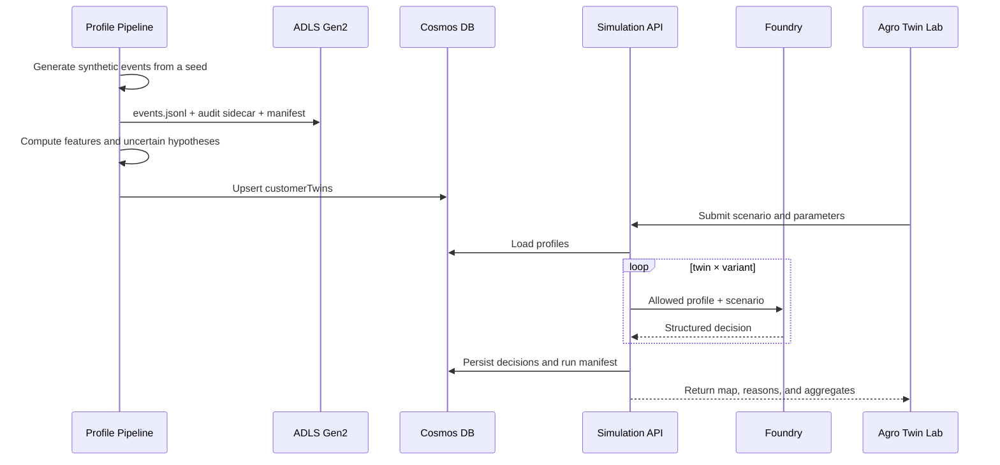

# Architecture

[Back to the README](../README.md)

## Core decisions

### Foundry is the agentic runtime, not the ETL layer

Microsoft Foundry hosts the model deployment, project endpoint, prompt-agent
definitions, identity boundary, and agentic observability. Transforming events
into profiles is a data workload and runs in an Azure Container Apps Job. A
production design could orchestrate that workload with Azure Data Factory or
Data Factory in Microsoft Fabric after an organization-specific review.

### Five governed definitions, one implemented runtime agent

The profile pipeline provisions versioned definitions for `customer-twin`,
`product-expert`, `risk-policy-critic`, `scenario-designer`, and
`portfolio-analyst`. The current simulation path invokes only `customer-twin`.
The other four definitions are not yet orchestrated and must not be represented
as active reviewers.

### Ephemeral customer-agent executions

The 120 customers are not 120 persistent Azure resources. The common
`customer-twin` definition receives immutable profiles and runs a clean
evaluation for each `twin × variant × repetition` combination.

This design reduces:

- provisioning cost and time;
- identity proliferation;
- cross-profile memory risk;
- configuration drift among agents.

### Deterministic baseline plus Foundry

The system has two independent engines:

1. `deterministic` computes an auditable utility decomposition;
2. `foundry` requests a structured choice and reason codes from the configured
   model or prompt agent.

The deterministic engine is never a silent fallback for Foundry. Every result
declares its engine and invocation mode. This separation makes it possible to
identify when a model-generated narrative diverges from a transparent rule.

## Data flow



The `/api/demo` route uses the latest complete canonical population from Cosmos
DB when Azure persistence is configured. Otherwise, it regenerates the
population in memory. Interactive Foundry requests are limited to 24 profiles;
the manual batch job handles the standard 120-profile run.

## Cosmos DB

| Container | Partition key | Content |
|---|---|---|
| `customerTwins` | `/id` | Current operational profile |
| `simulationRuns` | `/id` | Population/run manifests, versions, status, and aggregates |
| `twinDecisions` | `/twin_id` | Decision per run, variant, and twin |

Monthly events and the audit sidecar are not embedded in a twin profile. They
grow independently and remain in ADLS Gen2. The twin document contains only
features, uncertain hypotheses, and references that are read together.

The `Agro` segment is not a partition key because its low cardinality would
create a hot partition. A multitenant architecture must choose partition keys
after measuring real read/write patterns.

## ADLS Gen2

Validated population artifacts are written beneath the population artifact
digest:

```text
<artifact-digest>/
  events.jsonl
  audit-sidecar.jsonl
  manifest.json
```

Blob public access and shared-key access are disabled. The audit sidecar exists
to test the generator and proxy leakage; it is not sent to an agent.

## Identities and authorization

| Actor | Current access |
|---|---|
| Web Container App | Project-scoped Foundry Agent Consumer, Cosmos DB data contributor, Blob data contributor, ACR pull |
| Profile Job | Foundry User, Cosmos DB data contributor, Blob data contributor, ACR pull |
| Foundry Batch Job | Project-scoped Foundry Agent Consumer, Cosmos DB data contributor, Blob data contributor, ACR pull |
| Deployer | Foundry Project Manager and ACR push through the deploying principal |
| Foundry project identity | Foundry User on the parent account |

Only the Profile Job can author the managed prompt-agent versions. The web and
batch simulation runtimes can invoke project agents but cannot author them.

The application contains no service keys or credential-bearing connection
strings. Runtime access uses `DefaultAzureCredential`, managed identities, and
RBAC. Role scope and least privilege still require review before broader use.

## Network

The reference implementation uses identity-protected public endpoints for data
and AI services and restricts web ingress to a CIDR supplied by the deployer.
That is suitable only for a bounded non-production demonstration. A banking
deployment would additionally require:

- private endpoints;
- VNet integration;
- private DNS;
- restricted egress;
- Microsoft Entra authentication for the application;
- organizational policies and customer-managed keys when required.

These controls are documented requirements, not controls implemented by this
reference topology.

## Observability

Application Insights and Log Analytics receive operational telemetry. Traces
should use identifiers, versions, and hashes such as:

- `run_id`;
- `profile_id`;
- `scenario_hash`;
- `profile_digest`;
- `model_deployment`;
- agent and prompt version;
- `engine` and invocation mode;
- latency and token counts.

Raw events, audit attributes, secrets, and potentially sensitive profile
content must not be copied to telemetry.

See the [threat model](threat-model.md) for trust boundaries and residual risks.
