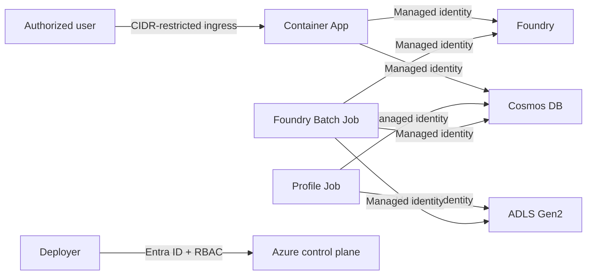

# Threat Model

[Back to the README](../README.md)

## Scope and assets

Protected assets include:

- synthetic operational profiles;
- the segregated audit sidecar;
- manifests, seeds, scenario hashes, and decisions;
- the Foundry project endpoint and agent definitions;
- web and job identities;
- logs and traces;
- the container image and registry;
- deployment configuration.

Real customer data, credentials, or confidential business data are out of scope
because they are prohibited in this reference implementation.

## Trust boundaries

The browser-to-web boundary relies on a deployer-supplied IP allow-list in the
reference environment. It does not provide user-level authentication.

## Threats and controls

| Threat | Reference control | Banking-production expectation |
|---|---|---|
| Unauthorized web access | IP allow-list | Entra authentication, authorization, and Conditional Access |
| Credential or key extraction | Local/shared-key auth disabled; managed identity | Preserve keyless access and least privilege |
| Prompt injection through a profile | Strict structured schema; no external profile content | Content provenance, sanitization, and adversarial testing |
| Cross-profile memory | Clean evaluation per profile | Isolation and leakage tests |
| Data poisoning | Versioned generator, specification, and manifest | Lineage, approvals, quality gates, and monitoring |
| Tool-based exfiltration | No write/action tools | Explicit tool allow-list and egress policy |
| Supply-chain compromise | Lockfiles, CodeQL, and Dependabot | Signing, SBOM, provenance, and admission policy |
| Tampered image | Private ACR content with RBAC | Signing/content trust and deployment policy |
| Sensitive data in logs | Synthetic-only policy and identifier-based telemetry | Redaction, DLP, access controls, and retention enforcement |
| Misuse of output | Persistent warning and prohibited-use documentation | Policy enforcement, model inventory, training, and monitoring |
| Overwrite or partial persistence | Pending/complete/failed run status | Transaction design, reconciliation, and recovery procedures |

## Residual risks accepted by the reference implementation

- Cosmos DB and Blob Storage use private endpoints and private DNS, while
  Foundry, ACR, and telemetry remain public identity-protected endpoints;
- web access is restricted by IP rather than authenticated through Entra ID;
- a Global Standard model SKU can process outside the deployment region;
- agent output can be plausible, variable, biased, or unsupported despite
  schema validation;
- the profile pipeline and batch job have no automatic replica retry;
- the environment is designed exclusively for synthetic data.

These residual risks make the environment suitable only for non-production
validation.

## Security validation priorities

Before a public release or material deployment:

1. scan source and history for secrets and identifiers;
2. verify RBAC and disabled local-auth settings;
3. test agent payload and cross-profile isolation;
4. exercise invalid structured outputs and persistence failures;
5. verify logs do not contain raw profiles or audit attributes;
6. review dependencies, container provenance, and CodeQL results;
7. confirm the warning remains visible in UI and exported results;
8. document incident response and data deletion ownership.

Report vulnerabilities according to [SECURITY.md](../SECURITY.md).
